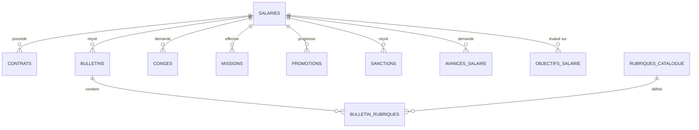

# NETIX SIRH 2.0 — CAHIER DE VISION PRODUIT & DESIGN ARCHITECTURE 2026
**Standard Fintech Haut de Gamme (Ramp / Mercury) · Modèle d'Interaction Spreadsheet 2026**

---

## 1. VISION DU PRODUIT & THÈSE DE RUPTURE

### 1.1 Le Constat Terrain : La Douleur de DLG PC PAIE
En Algérie, la gestion de la paie dans les PME et grandes entreprises (50 à 500 salariés) est encore massivement dominée par des logiciels conçus dans les années 1990 (principalement **PC PAIE de DLG** ou des ERP lourds mal adaptés comme Odoo).
- **L'expérience DLG PC PAIE** : Interface Windows 95/XP austère, codes de rubriques cryptiques (R100, R280, R522) à mémoriser par cœur, boîtes de dialogue modales rigides, navigation 100% manuelle, éditions papier matricielles d'un autre siècle, et zéro visibilité analytique pour la direction.
- **Le besoin réel d'un Chef de Service RH (200 salariés)** : Le gestionnaire veut la **vélocité de saisie au clavier** d'un tableur, mais avec la **sécurité absolue d'un moteur de paie certifié**, la beauté d'une **Fintech moderne (Ramp / Mercury / Stripe)**, et une traçabilité juridique totale face aux inspecteurs du travail et de la CNAS.

### 1.2 La Thèse Netix SIRH 2.0
Netix SIRH 2.0 n'est pas un formulaire administratif web de plus.  
C'est un **Tableur Financier Augmenté ("Spreadsheet 2026")** :
1. **Saisie au kilomètre sans souris** : Navigation fluide aux flèches directionnelles, Tabulation et Entrée pour piloter 200 collaborateurs en quelques minutes.
2. **Cascade temps réel 0 ms** : Chaque modification de cellule (ex: 8 heures d'absence ou 3 jours de panier) recalcule instantanément le Brut, la CNAS, l'IRG barème Art. 104 et le Net à Payer, tout en actualisant la masse salariale totale en bas d'écran.
3. **Double niveau de lecture (Spreadsheet + Inspection Drawer)** : La rapidité d'un grand livre comptable à gauche, combinée à un volet latéral d'audit juridique pour inspecter un bulletin complet sans quitter le tableau.

---

## 2. ÉCOSYSTÈME TECHNIQUE & LIENS DE PRODUCTION

| Composant | URL / Ressource | Statut |
| :--- | :--- | :--- |
| **Dépôt GitHub** | [https://github.com/kheireddine178/Netix-sirh](https://github.com/kheireddine178/Netix-sirh) | `origin/main` actif (v2.0) |
| **Application en Production (Vercel)** | [https://netix-paie.vercel.app](https://netix-paie.vercel.app) | Déploiement automatique continu (Edge/Serverless) |
| **Base de Données & Auth (Supabase)** | PostgreSQL 15 managé + RLS + Audit Logging | Hébergé dans le Cloud Supabase |
| **Moteur de Paie** | `lib/paieCalcul.ts` & `lib/rubriquesDynamiques.ts` | 10/10 tests Golden conformité 0,00 DA |
| **Générateur PDF Officiel** | `@react-pdf/renderer` (Bulletins, Décisions, Ordres de Mission) | Standard JORADP |

---

## 3. PERSONA & JOB-TO-BE-DONE (JTBD)

### 3.1 Profil de l'Utilisateur Clé
- **Rôle** : Chef de Service RH & Responsable Paie.
- **Périmètre** : 200 collaborateurs (ouvriers, agents de maîtrise, cadres, CDD, CDI).
- **Fréquence** : Pic critique entre le 22 et le 31 de chaque mois.
- **Responsabilités** :
  - Clôturer la paie mensuelle sans aucune erreur de calcul.
  - Déclarer les cotisations CNAS (9% salariale / 26% patronale) avant le 15 du mois suivant.
  - Reverser l'IRG retenu à la source à la recette des impôts (DGI) avec bordereau G50.
  - Générer les ordres de virement bancaire / CCP pour payer les salariés à date fixe.

### 3.2 Le Job-To-Be-Done (JTBD)
> *« Quand arrive la fin du mois, je veux importer ou saisir en masse les variables de mes 200 salariés au clavier comme dans Excel, voir immédiatement l'impact financier global, et sortir les bulletins PDF et les états de virement en 1 clic, sans jamais risquer un redressement fiscal ou CNAS. »*

---

## 4. ARCHITECTURE COMPLÈTE DE LA BASE DE DONNÉES (SUPABASE)

La base PostgreSQL sur Supabase est structurée autour de **11 tables relationnelles** garantissant l'intégrité référentielle et la conformité légale algérienne :



### 4.1 Modèle Détaillé des Tables

#### 1. `salaries` (Référentiel des Collaborateurs)
- `id` (int PK) : Identifiant unique.
- `nom_prenom` (varchar) : Nom et prénom complets.
- `matricule` (varchar unique) : Code matricule interne (ex: M001).
- `fonction` (varchar) : Titre du poste (ex: Comptable, Chauffeur, Ingénieur).
- `type_contrat` (varchar) : CDI, CDD, CTA, etc.
- `salaire_base_theorique` (numeric) : Salaire mensuel de base conventionnel (en Dinars Algériens).
- `date_embauche` (date) : Date de prise de fonction.
- `num_ss` (varchar) : Numéro de Sécurité Sociale (CNAS).
- `ccp_rib` (varchar) : Compte courant postal ou bancaire pour le virement.
- `mode_paiement` (varchar) : Virement, Chèque, Espèces.
- `situation_familiale` (varchar) : Célibataire, Marié(e), Divorcé(e).
- `enfants_a_charge` (int) : Nombre d'enfants mineurs/à charge.
- `actif` (boolean) : Collaborateur en poste ou sorti des effectifs.

#### 2. `bulletins` (Historique & Clôtures Mensuelles)
- `id` (int PK) : Identifiant du bulletin.
- `salarie_id` (int FK -> salaries.id) : Salarié concerné.
- `annee` (int), `mois` (int) : Période de paie (ex: 2026, 10). Contrainte UNIQUE (`salarie_id, annee, mois`).
- `salaire_base_theorique` (numeric) : Base avant déductions.
- **Absences déductibles (Loi 90-11)** : `maladie_h`, `mise_a_pied_h`, `accident_travail_h`, `retard_h`, `absence_irreguliere_h`.
- **Heures supplémentaires** : `heures_sup_1` (+50%), `heures_sup_2` (+75%), `heures_sup_3` (+100%).
- **Primes courantes** : `icr`, `taux_iep` (ancienneté), `taux_nuisance`, `taux_responsabilite`, `taux_disponibilite`, `taux_pri`, `taux_prc`, `panier_jours`, `panier_forfait_jour`, `autre_prime_fixe`.
- **Retenues** : `cotis_mutuelle`, `autres_retenues`.
- `statut` (varchar) : `'Brouillon'`, `'Validé'`, `'Clôturé'`.
- `modifie_le` (timestamp) : Horodatage dernière modification.

#### 3. `bulletin_rubriques` & `rubriques_catalogue` (Les 402 Rubriques)
- `rubriques_catalogue` :
  - `code` (varchar PK, ex: `R280`, `R522`) : Code officiel.
  - `libelle` (varchar) : Désignation (ex: INDEMNITE DE NUISANCE).
  - `type_valeur` (varchar) : `Gain (+)` ou `Retenue (-)`.
  - `cotisable` (varchar) : `OUI` ou `NON` (impact CNAS).
  - `imposable` (varchar) : `OUI`, `NON` ou `IRG` (impact Art. 104).
- `bulletin_rubriques` :
  - `bulletin_id` (int FK), `rubrique_code` (varchar FK), `valeur_1` (numeric), `valeur_2` (numeric).

#### 4. `contrats` & `documents_salaries`
- `contrats` : `id`, `salarie_id`, `type_contrat`, `date_debut`, `date_fin`, `periode_essai_mois`, `statut`, `salaire_base_contrat`.
- `documents_salaries` : `id`, `salarie_id`, `nom_document`, `categorie`, `fichier_url`.

#### 5. `conges`, `missions`, `promotions`, `sanctions`, `avances_salaire`
- Modules RH assurant la traçabilité des absences, ordres de mission avec indemnité de déplacement, décisions de sanction (Loi 90-11 Art. 73) et acomptes déductibles sur bulletin.

#### 6. `audit_logs` (Piste d'Audit Inaltérable)
- `id` (int PK), `auteur_id` (uuid), `auteur_email` (varchar), `table_cible` (varchar), `type_action` (`INSERT`, `UPDATE`, `DELETE`), `enregistrement_id` (int), `valeurs_apres` (jsonb), `cree_le` (timestamp).

---

## 5. LE MOTEUR DE PAIE ALGÉRIEN (SANCTUAIRE LÉGAL)

Le moteur dans `lib/paieCalcul.ts` implémente rigoureusement les textes de lois publiés au Journal Officiel de la République Algérienne (JORADP) :

### 5.1 La Cascade de Calcul Légale
```
[1] Salaire de Base Réel = SB Théorique − Retenues pour Absences (Taux horaire × Heures)
    ↓
[2] Salaire BRUT Total = SB Réel + IEP + Primes cotisables + Primes non cotisables (Panier/Transport) + Heures Sup
    ↓
[3] Assiette CNAS = Salaire BRUT − Primes non cotisables (Panier, Transport, Frais)  [Ord. 95-01 Art. 1]
    ↓
[4] Cotisation CNAS Salariale = Assiette CNAS × 9 %  [Loi 83-11 Art. 52]
    ↓
[5] Base Imposable IRG = Salaire BRUT − CNAS Salariale  [CIDTA Art. 68 & 104]
    * Le panier et le transport restent imposables à l'IRG car non exonérés à l'Art. 68.
    ↓
[6] Barème Progressif IRG Mensuel (6 tranches CIDTA Art. 104) :
    • 0 à 20 000 DA        → 0 %
    • 20 001 à 40 000 DA   → 23 %
    • 40 001 à 80 000 DA   → 27 %
    • 80 001 à 160 000 DA  → 30 %
    • 160 001 à 320 000 DA → 33 %
    • Supérieure à 320 000 → 35 %
    ↓
[7] Abattement Légal 40 % sur IRG Brut :
    • Min = 1 000 DA/mois | Max = 1 500 DA/mois.
    • Si Base IRG ≤ 30 000 DA → Exonération totale (IRG = 0).
    • Zone de lissage (30 001 à 42 500 DA) → 2e formule d'abattement dégressif.
    ↓
[8] NET À PAYER = Salaire BRUT − CNAS 9% − IRG Net − Autres retenues (Avances, Mutuelle)
    * Arrondi réglementaire au Dinar le plus proche (Loi de Finances).
    ↓
[9] Charges Patronales CNAS (26 %) = Assiette CNAS × 26 %
    Coût Total Employeur = Salaire BRUT + CNAS Patronale
```

---

## 6. DESIGN SYSTEM FINTECH 2026 (STANDARD RAMP / MERCURY)

### 6.1 Principes Fondateurs
1. **Élégance discrète (Quiet Luxury)** : Pas de dégradés agressifs ni de violet néon. Une palette inspirée de la finance haut de gamme suisse et américaine :
   - Fond d'application : Blanc chaud / Gris feutré studio (`#F8FAFC` / `#FAFAFB`).
   - Surfaces de données : Blanc pur (`#FFFFFF`) avec micro-bordures subtiles (`border-slate-200/80`).
   - Typographie : Sans-serif contemporaine (Inter / Plus Jakarta Sans) avec espacements métriques stricts.
2. **Chiffres Tabulaires sans Zéros Barrés (`tabular-nums` + `zero 0`)** :
   - Les montants s'alignent au pixel près verticalement pour une lecture comptable instantanée.
   - Les zéros sont ronds et pleins (`00 000,00 DA`), bannissant les polices de terminal type hacker (`Consolas 0̸`).
3. **Densité d'Information Balancée (Fintech Density)** :
   - Présenter 200 lignes sans donner l'impression d'étouffer. Lignes de tableau fines (hauteur 40px), séparateurs doux (`#F1F5F9`), survol soyeux.

---

## 7. LE PARADIGME : "SPREADSHEET 2026" POUR 200 SALARIÉS

Pour un Chef de Service RH qui gère 200 personnes, faire défiler 200 pages de formulaire une par une est inacceptable.  
Le module central de Netix devient donc le **Tableur Dynamique Intelligent** :

```
┌──────────────────────────────────────────────────────────────────────────────────────────────────────────────────┐
│ SPREADSHEET 2026 — Saisie Mensuelle Octobre 2026 (200 Collaborateurs)                  [Copier M-1] [Clôturer]   │
├─────────┬──────────────────────┬──────────────┬─────────────┬───────────┬─────────────┬────────────┬────────────────┤
│ Matr.   │ Collaborateur        │ Base (DA)    │ Absences(h) │ HS 50%(h) │ Panier(j)   │ Brut Total │ NET À PAYER    │
├─────────┼──────────────────────┼──────────────┼─────────────┼───────────┼─────────────┼────────────┼────────────────┤
│ M001    │ Amina Benali         │ 50 000,00    │ [ 0.0     ] │ [ 4.0   ] │ [ 22      ] │ 63 687,50  │ 52 340,00 DA   │
│ M002    │ Karim Hadj           │ 75 000,00    │ [ 8.0     ] │ [ 0.0   ] │ [ 20      ] │ 81 540,00  │ 62 110,00 DA   │
│ M003    │ Yacine Mansouri      │ 42 000,00    │ [ 0.0     ] │ [ 8.0   ] │ [ 22      ] │ 55 200,00  │ 44 890,00 DA   │
│ ...     │ (197 autres lignes)  │ ...          │ ...         │ ...       │ ...         │ ...        │ ...            │
├─────────┴──────────────────────┴──────────────┴─────────────┴───────────┴─────────────┼────────────┼────────────────┤
│ MASSE SALARIALE GLOBALE : 14 850 000 DA · CNAS 26% : 3 861 000 DA · IRG : 1 420 000 DA│ NET TOTAL  │ 11 820 000 DA  │
└───────────────────────────────────────────────────────────────────────────────────────┴────────────┴────────────────┘
                                  ▲ Clavier : Flèches ↑ ↓ ← → | Tab | Entrée | Espace (Inspecter)
```

### 7.1 Fonctionnalités Clés du Spreadsheet 2026 :
- **Navigation 100 % Clavier** : Déplacement naturel d'une cellule à l'autre sans souris.
- **Calcul en Cascade Instantané (0 ms)** : Modification d'une absence = recalcul direct du Net de la ligne + mise à jour immédiate du compteur de masse salariale en bas de page.
- **Barre d'Actions Collectives** :
  - *« Appliquer Panier 22 jours à tout le monde »* en 1 clic.
  - *« Importer les variables du mois M-1 »* pour ne saisir que les deltas du mois.
- **Inspecteur Latéral Flottant (Space bar)** : Appuyer sur `Espace` sur une ligne ouvre un volet latéral élégant avec le bulletin détaillé, l'explication fiscale Art. 104 et le bouton d'impression PDF.

---

## 8. FEUILLE DE ROUTE D'EXÉCUTION (ROADMAP)

### Jalon 1 : Le Moteur Spreadsheet 2026 (Cœur Opérationnel)
- Implémentation du composant Tableur Haute Performance pour 200 salariés.
- Colonnes éditables en ligne : Absences, Heures Sup, Panier, Primes, Acomptes.
- Barre de synthèse financière temps réel en pied de tableau.

### Jalon 2 : L'Inspecteur de Bulletin & Générateur PDF
- Volet rétractable d'inspection fiscale et légale.
- Téléchargement et impression directe du bulletin de paie au standard officiel algérien.

### Jalon 3 : Clôture de Période & Bordereaux CNAS / G50
- Workflow de verrouillage de la paie en fin de mois.
- Génération automatique de l'état récapitulatif pour la déclaration CNAS (Bordereau 9% + 26%) et le virement bancaire de masse.

### Jalon 4 : Dossier Collaborateur 360° & Contrats
- Fiche collaborateur épurée avec vue chronologique des salaires, contrats, congés et sanctions.

---
*Document approuvé pour le développement de Netix SIRH 2.0.*
